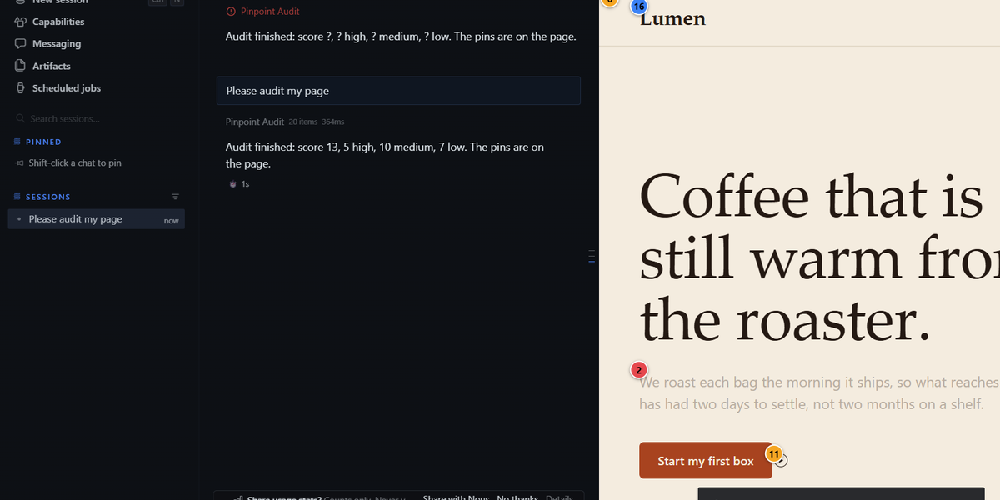
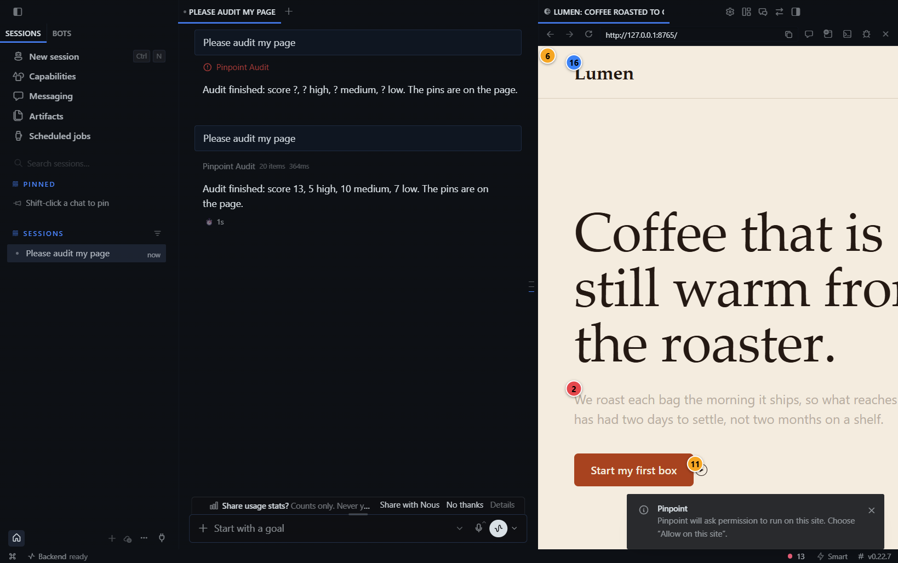
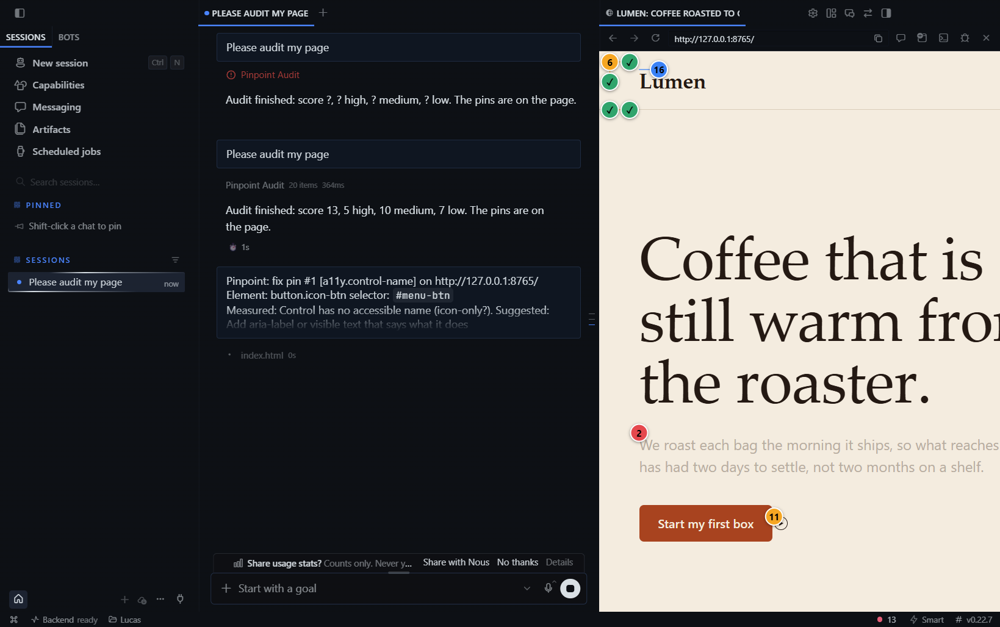
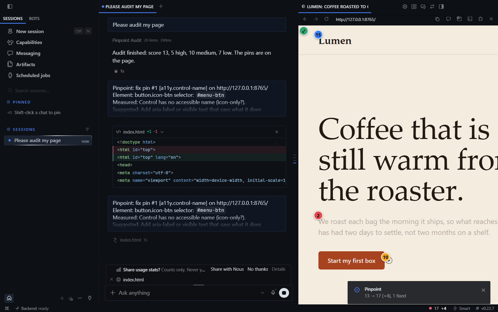
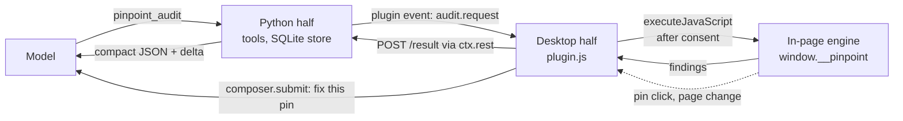

# Pinpoint

<!-- FILL:banner  docs/banner.png (1200x600, 2:1). See docs/fill-images.md -->


Pinpoint measures the page open in Hermes Desktop's Browser pane, pins numbered markers on the real elements that fail, and lets you send one pin to the agent as a fix task. When the page changes, it audits again: pins turn green and you get a score delta.

The agent does not have to guess whether a CSS change worked. `pinpoint_audit` returns measured numbers (contrast ratio, pixel sizes, selectors), and a second call returns `delta` with the ids that are now fixed.

## Install (30 seconds)

Needs Hermes Desktop with agent `>=0.22.7`.

```bash
hermes plugins install stupidburgers/pinpoint     # once listed: hermes plugins install pinpoint
hermes plugins enable pinpoint                    # Python half: tools, store
```

Then enable the second half in Desktop: **Capabilities > Plugins > Pinpoint**. Both halves must be on. On the build I tested, the Desktop half did not register until it was enabled explicitly.

Use it: open a page in the Browser pane (`Ctrl+Shift+L`), run **Pinpoint: audit page** from the command palette (or ask the agent to audit the page). The first time per site, Desktop asks "Let Pinpoint run scripts on this page?". Choose *Allow on this site*.

> Status: this README describes the design in SPEC.md. Sections marked FILL or listed under "Not verified yet" are not backed by a run yet.

## What you get

<!-- FILL:screenshots  3 images from docs/screenshots/. See docs/fill-images.md -->
| Audit and pins | Pin card, Fix with Hermes | Re-audit after the fix |
|---|---|---|
|  |  |  |

Two agent tools:

| Tool | Does |
|---|---|
| `pinpoint_audit` | Runs the checks on the open page, draws pins, returns findings (rule, severity, CSS selector, measured values, fix hint). Called again after an edit it adds `delta`: fixed, new and remaining ids, score before and after. |
| `pinpoint_pins` | `list` stored pins for a page, `dismiss` a finding as intentional (needs a reason, and the user's agreement), `reopen`, `clear`. |

14 rules, WCAG 2.2 thresholds: text contrast, tap-target size, missing `alt`, unlabeled form fields, unnamed buttons and links, heading order, focus indicator removed, `lang`, page title, zoom blocked by the viewport meta, horizontal overflow, text under 12 px, tight line height, tightly spaced targets. Full table in [SPEC.md section 5](SPEC.md).

## How it works



- The engine is one plain JS function, no dependencies. It reads computed styles and layout, never calls `.focus()` or clicks anything.
- Ids are stable hashes of the element's role and position in the page, not of the thing the fix changes. "Fixed" means the id is gone on the next audit.
- A pin click only submits a visible chat message when you click. Nothing is auto-sent.
- No hooks, no middleware, no subprocess, no network. Public SDK surfaces only.

## How it differs from what is already around

| Existing | What it works on | Pinpoint |
|---|---|---|
| impeccable (`hermes-plugin`) | UI **source files**, via a hook and a CLI detector | Measures the **rendered page**, draws an overlay, no hook, no subprocess |
| redline | Markdown and code review, sidecar annotations | Different object: a live UI, with measurement |
| word-peek | Reads an HTML passage or selection through `ctx.preview` | Audits the whole page by rule and draws on it; same consent door |
| hardlight-ui | Design guidance, source inspection, a contrast calculator | Live page in the Desktop pane, verified fix loop |
| hermes-ios | Native iOS visual iteration | Different platform |

The claim I can back is narrow: a grep of the catalog descriptions for preview, a11y, contrast and wcag (2026-11-04) found no entry that draws measured findings on the live Browser pane. I did not read their source.

## Consent

Desktop's host-owned dialog asks per site before any script runs in the page. Pinpoint cannot change its text, so the pane shows a short explanation card first. Deny and the audit returns `consent_denied`. Revoke any time under Capabilities > Plugins > Pinpoint.

## Limits

- Contrast skips any text with a `background-image` or gradient behind it and says so in `limits`. It does not guess.
- The focus-indicator rule is a static CSS scan (same-origin stylesheets only), so it is a heuristic and is marked `heuristic: true`.
- Cross-origin stylesheets, cross-origin iframes and closed shadow roots are not scanned. Same-origin iframes are read to depth 2.
- Over 5,000 elements, only the viewport plus 2 screens above and below are audited.
- Pins render at most 60 per page. Targets outside the viewport get a pin once scrolled into view.
- Pin clicks and page changes reach the agent through polling (0.5-1 s), because the host has no page-to-plugin push.
- It measures. It does not tell you a design is good, and it is not a replacement for a screen reader pass.

### Not verified yet

Fill this list from the real test run before freeze. Items below are the ones I know are open:

- macOS and Linux: no OS-specific code, but only Windows 11 was run.
- Hermes versions other than 0.22.7 (Desktop 2026.7363.3271.0).
- The consent *Deny* path was not exercised in the spike.
- Whether a real model reliably picks `pinpoint_audit` unprompted (tools are deferred; a system-prompt line names both).
- Multi-window claim race (designed, not measured).
<!-- FILL:not-verified  update against docs/metrics.md and the e2e results; delete lines that got verified -->

## Measured results

<!-- FILL:metrics  paste the table from docs/metrics.md (precision/recall on tests/engine/labeled, latency). Do not write numbers that are not in that file. -->
See [docs/metrics.md](docs/metrics.md). Not yet generated.

## Develop

Use an external virtual environment and pytest basetemp. See
[the reproducible full-tree validation recipe](docs/packaging.md) and
`.github/workflows/ci.yml` for pinned test dependencies and the floor Hermes
CLI installation. These checks are headless; they do not start the gateway.

`desktop/plugin.js` is generated from `desktop/src/app.js` plus the engine, because disk plugins cannot import sibling files.

## Disclosure

Disclosure - Pinpoint's desktop half runs its own audit script inside the web page open in Hermes Desktop's Browser pane, only after you allow it for that site (Desktop's per-origin consent dialog; revocable under Capabilities > Plugins); the script reads computed styles, layout and attribute names (not form values or cookies) and draws an overlay. Findings (CSS selectors, short element labels, measured values) are stored in a local SQLite file under the plugin-data folder (`pinpoint/data.db`, 20 pages max) and are sent to the model only when the agent calls `pinpoint_audit`/`pinpoint_pins` or when you click Fix on a pin; element labels originate from the page. The desktop half polls the page every 0.5-1 s while pins are shown (via `executeJavaScript`) and re-audits automatically after page changes (switch off in the pane). `pinpoint_audit` blocks up to 90 s waiting for the Desktop (configurable) and returns `desktop_unavailable` when no Desktop window answers, including under cron. No network calls, no subprocesses, no shell, no credentials, no telemetry, no files written outside plugin-data; it never edits your source (the agent does, under normal approvals).

## License

MIT. See [LICENSE](LICENSE).
